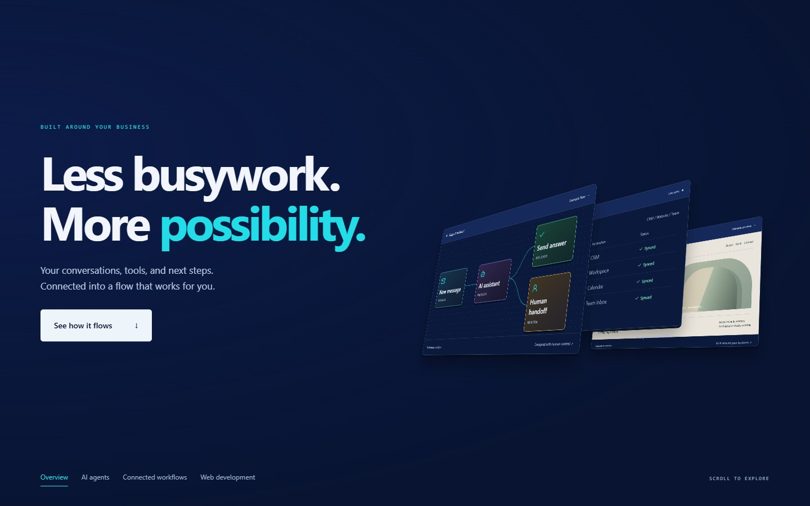

# Automate Flows Design Collection

Reusable designs, examples and implementation prompts by Troy Lorents.

[Live collection](https://troyjlorents-gh.github.io/automateflows-design-collection/) · [21st component](https://21st.dev/@troyjlorents-gh/components/dimensional-workflow-hero) · [Original full showcase](https://troyjlorents-gh.github.io/automateflows-design-collection/?showcase)

```sh
npx @21st-dev/cli add @troyjlorents-gh/dimensional-workflow-hero
```



## Two examples, one collection

| Item | Purpose | Source |
| --- | --- | --- |
| Dimensional Workflow Hero | Compact reusable 3D scroll component published to 21st. Supply your own panel content. | [Component](components/dimensional-workflow-hero/DimensionalWorkflowHero.tsx), [demo](components/dimensional-workflow-hero/DimensionalWorkflowHero.demo.tsx), [custom example](examples/dimensional-workflow-hero/CustomizedHero.tsx) |
| Full workflow showcase | Original detailed workflow nodes, database, code and finished-site scenes. Retained as a complete example. | [Full source](examples/full-workflow-showcase/DimensionalWorkflowHero.tsx), [demo](examples/full-workflow-showcase/DimensionalWorkflowHero.demo.tsx) |

The October 12 compact release changes the published component API. Earlier integrations using `content` or `defaultHeroContent` can keep their existing version or use the full showcase source above. The published version now takes `title` and `chapters` with React `panel` slots.

## Use the compact component

```sh
npm install gsap @gsap/react
```

Copy the component into your React project. Its scoped CSS is included. No Tailwind, image assets, font download, router or backend is required. The example demo additionally uses `lucide-react` for icons.

```tsx
import DimensionalWorkflowHero from './DimensionalWorkflowHero';

export default function Page() {
  return <DimensionalWorkflowHero
    title={<>Good ideas.<br /><em>Working systems.</em></>}
    description="A brief introduction to your work."
    accent="#22dde7"
    chapters={[
      { label: 'Discover', title: 'Start with the real work.', panel: <YourFirstPanel /> },
      { label: 'Build', title: 'Connect the pieces.', panel: <YourSecondPanel /> },
      { label: 'Launch', title: 'Put it to work.', panel: <YourThirdPanel /> },
    ]}
  />;
}
```

Supply one to five chapters. Each has `label`, `title`, optional `description`, and `panel`. Panels can contain diagrams, screenshots or React UI. Keep panel controls decorative: only the focused chapter is exposed to keyboard and assistive technology while the desktop timeline runs. Design panels for a 720 × 430 desktop canvas and a fluid static mobile layout. Optional `data-hero-step` elements lift in sequence during their chapter.

Optional props: `eyebrow`, `description`, `finale` (React content), `accent`, `className`, `style`, `viewportsPerChapter` (default 1.35) and `scrub` (default 0.65 seconds). The accent inherits `--color-primary` with a cyan fallback. Typography inherits the host font. Use the scoped `--dwh-bg` variable to change the dark canvas.

The desktop scene scales into embedded previews down to a 600px viewport width and 360px height. Pin and scroll measurements use the actual viewport. Smaller viewports and reduced-motion preferences get the same content in a static reading sequence. There is no motion toggle or stored preference override. The overview button, chapter navigation and skip link are included. Avoid placing the hero inside transformed ancestors or custom scrolling containers without adapting the ScrollTrigger configuration.

## Run locally

```sh
npm ci
npm run dev
npm run build
```

Node.js 20.19+ or 22.12+ is required by Vite. The default page runs the compact demo. `?showcase` opens the preserved full example. Development checks can use `?chapters=1`, `?chapters=5` or `?instances`.

## Prompts and publishing

[Short installation prompt](prompts/dimensional-workflow-hero/INSTALL.md) · [Build prompt](prompts/dimensional-workflow-hero/BUILD.md) · [Adaptation prompt](prompts/dimensional-workflow-hero/ADAPT.md)

[21st publishing record](publishing/21st/dimensional-workflow-hero.md) · [Validation](publishing/VALIDATION.md) · [Credits and asset boundaries](ATTRIBUTION.md)

This repository is a reusable adaptation of work at [Automate Flows](https://automateflows.io/). It does not include the site's complete source or client data. Social copy is a draft, not a record of sent messages.

### Motion preview

[Watch the recorded 3D scroll sequence](components/dimensional-workflow-hero/preview.mp4). The default demo includes a workflow diagram, connected records and an illustrative website.
